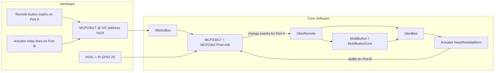

# Bedberry Core Architecture (for Python Reimplementation)

## Scope
This document captures the core control plane for bed hardware and input handling:
- MCP23017 I2C GPIO expander access and interrupt behavior
- Bed actuator control (`OkinBed`, `Actuator`)
- Remote input and multibutton interpretation (`OkinRemote`, `MultiButton`, `MultiButtonCore`)

Out of scope:
- Alexa integration
- Accelerometer/target-angle loop (except where it affects class boundaries)

## 1. High-Level Architecture

## 2. Startup and Wiring

### Runtime bootstrap
1. Register MCP23017 device type.
2. Open I2C bus (bus 1).
3. Create configured I2C devices from `cfg/i2c.json5`.
4. Instantiate `OkinBed` using `cfg/okin.json5`.
5. Instantiate `OkinRemote` using `cfg/okinRemote.json5`.

Relevant implementation files:
- `server/index.ts`
- `lib/WbI2cBus.ts`
- `lib/MCP23017.ts`
- `lib/OkinBed.ts`
- `lib/OkinRemote.ts`

### Configuration-driven topology
`cfg/i2c.json5` defines a single MCP23017 (`name: "okin"`, `address: 0x24`) with per-port settings:
- Port A (inputs): `int_gpio: 25`, `read_bits: 0xff`, `poll_period: 2000`, `default: 0xc0`
- Port B (outputs): `write_bits: 0x7f`

Then:
- `cfg/okin.json5` maps Port B bits to actuator control lines
- `cfg/okinRemote.json5` maps Port A bits to remote commands and multibutton definitions

## 3. I2C Layer and Device Model

## 3.1 `WbI2cBus`
Responsibilities:
- Open a Linux I2C bus synchronously (`openSync(busId)`).
- Provide register-byte operations:
  - `writeByteSync(addr, subaddr, data)`
  - `readByteSync(addr, subaddr)`

The read operation uses write-then-read transaction semantics:
- Write register address byte
- Read one byte from that register

## 3.2 `WbI2cDevice`
Base wrapper that binds:
- Device address
- Logical device name
- Shared bus access methods

`MCP23017` subclasses this base.

## 4. MCP23017 Integration Details

## 4.1 Register map used
The implementation uses these MCP23017 registers:
- `IODIR`, `GPPU`, `OLAT`, `GPINTEN`, `DEFVAL`, `IPOL`, `INTCON`, `INTCAP`, `GPIO`, `IOCON`

Port B registers are addressed as `reg + 1` (port offset 1), Port A as `reg + 0`.

## 4.2 Per-port initialization sequence (`MCP23017Port.initSetup`)
For each port:
1. Direction: `IODIR = 0xff ^ write_bits`
2. Pullups: `GPPU = 0xff`
3. Output latch default: `OLAT = 0x00`
4. Interrupt and compare defaults:
   - `GPINTEN = 0x00`
   - `DEFVAL = 0x00`
   - `IPOL = 0x00`
   - `INTCON = 0x00`
5. Clear pending conditions by reading `INTCAP` and `GPIO`
6. If outputs exist (`write_bits != 0`), write `GPIO = write_bits`
7. If interrupt pin configured:
   - Attach falling-edge callback on Raspberry Pi GPIO (`int_gpio`)
   - Program interrupt mode:
     - `int_on_change = true`: `INTCON = 0xff ^ read_bits`
     - else: `DEFVAL = default`, `INTCON = read_bits`
   - Enable interrupt bits: `GPINTEN = read_bits`

## 4.3 Change detection behavior
When interrupt fires (or polling runs):
- Read `GPIO` value.
- Compute changed input bits: `diff = (new_value XOR prev_value) & read_bits`.
- If any bit changed, emit event: `change(diff, new_value)`.

This event is the central source for remote and multibutton control.

## 4.4 Output behavior
`setBit(bit, val)` updates cached output byte (`curWrValue`) then writes `OLAT`.

Important actuator polarity in this project:
- "Stop" drives both control bits HIGH (`true`)
- Move commands drive one bit LOW, one HIGH
This indicates active-low output control lines to downstream relay/driver hardware.

## 5. Bed Control Core (`OkinBed` + `Actuator`)

## 5.1 `OkinBed`
Responsibilities:
- Resolve configured MCP port (e.g. `okin.B`).
- Create actuators (`head`, `feet`, optional `platform`).
- Expose command API:
  - `move(actuator, dir_is_up, duration?)`
  - `up(...)`, `down(...)`
  - `stop(actuator)`
  - `stopAll()`

For this port effort, accelerometer target mode can be ignored.

## 5.2 `Actuator`
Each actuator maps two MCP output bits:
- `up` bit
- `down` bit

Command processing model:
- Queue incoming commands.
- Process next command on event-loop tick.
- State machine with two states: `Stopped`, `Moving`.
- `Move` command:
  - clear existing stop timer
  - set output bits for direction
  - start timer for auto-stop after duration
- `Stop` command:
  - clear existing stop timer
  - drive both bits to stop polarity

Safety behavior:
- Every move has a timer-backed auto-stop (default duration if omitted).

## 6. Remote Input and Multibutton

## 6.1 `OkinRemote`
Subscribes to `change(bits, value)` from remote input MCP port (Port A).

It splits changed bits into two logical groups:
- `bedMask`: direct actuator up/down buttons
- `mbMask`: multibutton inputs

### Direct bed button behavior
For each changed bed-control bit:
- If bit becomes 1 (released/high in this wiring): starts movement with 60s timeout.
- If bit becomes 0 (pressed/low): issues stop for that actuator.
- If aggregate `value == 0`: global `stopAll()`.

Note: This is polarity-sensitive and intentionally mirrors existing wiring semantics.

### Multibutton routing
For each multibutton definition:
- If its mask intersects changed bits, call `inputChange((value & mask) == 0)`.
- This converts active-low electrical signal to logical `pressed=true`.

## 6.2 `MultiButtonCore` state machine
A compact finite-state machine classifies single input stream into:
- click with count index
- hold with count index
- release

States:
- `IDLE`
- `WAIT_RELEASE_OR_HOLD`
- `WAIT_PRESS`
- `HOLDING`

Timers:
- `wait_release`: max press duration before hold event
- `wait_press`: inter-click gap before click series ends

Emitted events:
- `click(count)` when press/release sequence completes
- `hold(count)` when button remains pressed beyond `wait_release`
- `release(count)` on release after hold

Count semantics:
- First click/hold has `count = 0`
- Second has `count = 1`, etc.

## 6.3 `MultiButton` action binding
`actions` array index maps to event `count`.
Each index can define either:
- `click` action
- `hold` action

Action types:
- `bed`: movement command to actuator; on hold, release callback stops actuator
- `url`: HTTP GET call
- `ext`: external command execution

For a Python hardware-core port, `bed` actions are essential; `url`/`ext` are optional integration hooks.

## 7. Effective Hardware Mapping in Current Config

## 7.1 MCP23017
- Bus: I2C bus 1
- Address: `0x24`
- Logical name: `okin`

## 7.2 Port B (outputs to bed actuators)
From `cfg/okin.json5`:
- Head: `up=0`, `down=2`
- Feet: `up=1`, `down=3`
- Platform: `up=4`, `down=5`

## 7.3 Port A (inputs from remote/buttons)
From `cfg/okinRemote.json5`:
- Head up/down: bits `0`/`3`
- Feet up/down: bits `1`/`2`
- Platform up/down: bits `5`/`4`
- Multibutton input: bit `6`

Interrupt pin:
- MCP Port A interrupt routed to Pi GPIO 25 (falling edge)

## 8. Python Reimplementation Blueprint

## 8.1 Suggested package choices
I2C (recommended):
- `smbus2` (stable, popular, thin over Linux i2c-dev)

GPIO interrupt handling (recommended):
- `gpiozero` (easy callbacks, broad community use) OR
- `RPi.GPIO` (classic) OR
- `lgpio` / `rpi-lgpio` (modern replacement trajectory)

If you want the closest low-level control style, use:
- `smbus2` + `RPi.GPIO` (or `rpi-lgpio` drop-in)

## 8.2 Python module decomposition
Suggested modules:
- `i2c_bus.py`: bus open/read/write primitives
- `mcp23017.py`: register constants, port class, interrupt/poll logic
- `actuator.py`: two-bit actuator state/timer handling
- `okin_bed.py`: actuator orchestration and public API
- `multibutton_core.py`: FSM logic
- `multibutton.py`: action dispatch
- `okin_remote.py`: input bit decoding, routing to bed/multibutton
- `config_loader.py`: JSON/JSON5 to dataclasses

## 8.3 Concurrency model in Python
Two viable patterns:
1. Threaded callbacks + timers
- GPIO interrupt callbacks in one thread
- `threading.Timer` for actuator auto-stop and FSM timers
- Guard shared state with `threading.Lock`

2. `asyncio` event loop
- Wrap GPIO edge events into loop callbacks
- Use `loop.call_later` for timers
- Cleaner if adding APIs/webhooks later

Given the existing Node event-loop design, `asyncio` maps naturally, but threaded style is simpler for first parity build.

## 8.4 Critical behavior to preserve
- Active-low semantics for remote inputs and actuator outputs.
- Register initialization order for MCP23017 ports.
- `diff` mask based change events (`(new ^ old) & read_bits`).
- Per-actuator move auto-timeout and immediate stop on release.
- MultiButton count-index mapping semantics.

## 9. Minimal Parity Test Plan

1. MCP init test
- Assert expected register writes occur for both ports.

2. Interrupt change test
- Simulate GPIO read transitions, verify emitted `diff/value`.

3. Actuator polarity test
- `move(up)` drives bit pair to expected active-low combination.
- `stop()` drives both bits high.

4. Remote mapping test
- Each configured remote bit maps to correct actuator+direction.

5. Multibutton FSM test
- Single click emits `click(0)`.
- Long press emits `hold(0)` and release callback stops actuator.

## 10. Known Quirks to Decide During Port

- `MultiButton` action setup uses `if click ... else if hold ...` per index, so one index cannot define both click and hold simultaneously.
- `OkinRemote` direct bed handling currently starts movement when a mapped bit is high and stops when low; preserve unless hardware validation says otherwise.
- Polling (`poll_period`) and interrupts can both be active; ensure duplicate events are harmless.

## 11. File Map (Source of Truth)
- `lib/WbI2cBus.ts`
- `lib/WbI2cDevice.ts`
- `lib/MCP23017.ts`
- `lib/Actuator.ts`
- `lib/OkinBed.ts`
- `lib/OkinRemote.ts`
- `lib/MultiButton.ts`
- `lib/MultiButtonCore.ts`
- `cfg/i2c.json5`
- `cfg/okin.json5`
- `cfg/okinRemote.json5`
- `server/index.ts`
